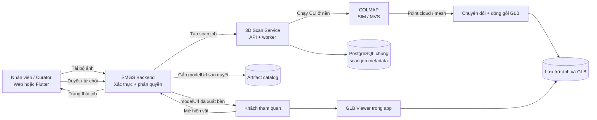

# Thiết kế hệ thống 3D Scan chạy nền trong SMGS

## 1. Mục tiêu

Cho phép nhân viên quản lý số hoá hiện vật thành mô hình 3D ngay trong quy trình của Smart Museum Guide System (SMGS). Người dùng thao tác trên giao diện SMGS; COLMAP là công cụ xử lý chạy nền, không mở giao diện COLMAP cho người dùng và không cần gọi dịch vụ tạo 3D thương mại.

Đầu vào là bộ ảnh chụp nhiều góc quanh **cùng một hiện vật**. Đầu ra là file GLB được curator kiểm tra trước khi gắn vào hồ sơ hiện vật. Đây là quy trình photogrammetry (dựng hình từ nhiều ảnh), không phải tạo model AI từ một ảnh đơn.

## 2. Kiến trúc đề xuất



### Vai trò các thành phần

| Thành phần | Trách nhiệm |
|---|---|
| Web/Flutter UI | Chọn hiện vật, tải bộ ảnh, theo dõi job, xem trước và duyệt model theo vai trò. |
| SMGS Backend | Xác thực người dùng, kiểm tra quyền, làm gateway tới scan service, lưu `modelUrl` sau khi duyệt. |
| 3D Scan Service | Nhận job, xếp hàng, gọi COLMAP, theo dõi kết quả và quản lý trạng thái xử lý. |
| COLMAP | Tìm vị trí camera từ ảnh, tái tạo point cloud và hình học 3D. Chạy CPU được nhưng chậm; GPU CUDA chỉ là tăng tốc tuỳ cấu hình. |
| GLB packaging | Chuyển mesh/texture sang GLB, tối ưu dung lượng và kiểm tra file trước khi lưu. |
| PostgreSQL | Lưu metadata/trạng thái job trong schema `ai_3d_scan`; dùng database hiện có của Backend. |
| File/object storage | Lưu ảnh gốc và GLB. PoC hiện dùng ổ đĩa local; triển khai nhiều instance cần storage dùng chung. |
| GLB Viewer | Tải model đã xuất bản và cho khách xoay/phóng to trong app. |

## 3. Luồng nghiệp vụ

1. Nhân viên mở hồ sơ hiện vật và chọn **Tạo mô hình 3D**.
2. UI hướng dẫn chụp/tải nhiều ảnh quanh hiện vật. Cần chụp đủ góc, ảnh rõ, vật thể không di chuyển và ánh sáng tương đối ổn định.
3. UI gửi ảnh tới Backend. Backend xác thực người dùng và chuyển yêu cầu tới 3D Scan Service; secret nội bộ không được đặt trong mã frontend/Flutter.
4. Scan Service tạo job và trả `scanJobId` cùng trạng thái `QUEUED`. UI hiển thị trạng thái; có thể polling endpoint trạng thái hoặc dùng cơ chế thông báo sau này.
5. Worker lấy job và chạy COLMAP ở nền. Trong lúc chạy, UI có thể hiển thị `PROCESSING`; người dùng không phải giữ cửa sổ COLMAP mở.
6. Khi tái tạo và đóng gói thành công, service lưu GLB và chuyển job sang `REVIEW_REQUIRED`. Nếu lỗi, chuyển `FAILED` kèm thông báo phù hợp.
7. Curator xem trước kết quả, duyệt hoặc yêu cầu chụp lại. Chỉ sau khi duyệt, Backend mới cập nhật `modelUrl` cho hiện vật.
8. Khách mở trang hiện vật; app tải `modelUrl` đã xuất bản và hiển thị bằng GLB Viewer.

## 4. Trạng thái job

```text
QUEUED → PROCESSING → REVIEW_REQUIRED → COMPLETED
              └────→ FAILED
REVIEW_REQUIRED → REJECTED / cần chụp lại
```

- `QUEUED`: đã nhận yêu cầu, chờ worker.
- `PROCESSING`: COLMAP và bước tạo GLB đang chạy.
- `REVIEW_REQUIRED`: GLB đã tạo, chờ curator kiểm duyệt.
- `COMPLETED`: đã duyệt và Backend đã gắn model vào hiện vật.
- `FAILED`: xử lý lỗi; lưu thông tin lỗi an toàn để nhân viên có thể thử lại.
- `REJECTED`: curator không chấp nhận model; có thể tạo job mới với bộ ảnh tốt hơn.

## 5. API giữa các thành phần

Các endpoint scan PoC hiện có:

```http
POST /api/v1/scans
Content-Type: multipart/form-data
X-Service-Key: <server-side-secret>

artifact_id: 123
capture_metadata: {"device":"iPhone Safari"}
images: <nhiều ảnh JPG/PNG>
```

Trả `202 Accepted` với `scanJobId`, `artifactId`, `status=QUEUED`.

```http
GET /api/v1/scans/{scanJobId}
```

Trả trạng thái `QUEUED`, `PROCESSING`, `REVIEW_REQUIRED` hoặc `FAILED`. PoC có endpoint approve nội bộ, nhưng bản tích hợp cần để Backend kiểm tra quyền curator và ghi audit log trước khi cập nhật catalog.

## 6. Tạo GLB và chất lượng

COLMAP tập trung vào tái tạo hình học/texture từ nhiều ảnh. Đầu ra của pipeline cần bước đóng gói và kiểm tra GLB riêng; không nên giả định mọi bản COLMAP tự xuất đúng GLB trong mọi cấu hình. PoC của nhóm yêu cầu các CLI `automatic_reconstructor`, `poisson_mesher` và `mesh_texturer`; cần xác minh phiên bản cài đặt có đủ lệnh tương ứng.

Tiêu chí kiểm tra curator có thể gồm:

- Hình dạng tổng thể khớp hiện vật, không bị thủng hoặc méo rõ rệt.
- Texture/màu sắc đủ dùng khi xoay model.
- Kích thước GLB hợp lý để tải trên mạng di động.
- Model mở được trong viewer mục tiêu và không vượt giới hạn bộ nhớ của điện thoại.
- Nếu thiếu góc hoặc ảnh phản chiếu làm hỏng kết quả, yêu cầu chụp lại thay vì xuất bản.

## 7. Triển khai theo giai đoạn

### Giai đoạn A — Demo đồ án

- Chạy Backend, Scan Service và COLMAP trên máy nhóm/máy trường.
- Một worker, một job tại một thời điểm; CPU được hỗ trợ nhưng thời gian chờ có thể dài.
- Dùng một hiện vật mẫu và bộ ảnh nhỏ đã kiểm tra.
- UI hiển thị trạng thái job và cho curator xem trước/duyệt.
- Lưu file trên ổ đĩa local và trình bày rõ đây là cấu hình demo.

### Giai đoạn B — Tích hợp hoàn chỉnh

- Nối UI scan với Backend gateway và phân quyền curator.
- Backend cập nhật `modelUrl` sau khi duyệt; thêm audit log.
- Đưa ảnh/GLB vào object storage thay vì ổ đĩa của một instance.
- Thêm queue bền vững, retry có giới hạn, timeout, dọn file tạm và giới hạn tải lên.
- Đo thời gian CPU/RAM/disk bằng bộ ảnh bảo tàng thật trước khi quyết định số worker hoặc có cần GPU.

## 8. Phạm vi và giới hạn cần trình bày

- Không tạo model từ một ảnh duy nhất; cần nhiều ảnh có vùng chồng lấp.
- CPU không cần thuê GPU nhưng thời gian dựng có thể lâu; demo nên tuần tự, không tuyên bố chịu tải production trước khi đo.
- COLMAP có thể không tái tạo tốt vật thể bóng, trong suốt, đơn sắc hoặc thiếu chi tiết.
- PoC hiện đã nhận job, chạy COLMAP và lưu trạng thái; Backend/UI chưa nối end-to-end, curator approval chưa kiểm tra role, `modelUrl` chưa tự cập nhật và media còn lưu local.
- Vì vậy khi thuyết trình cần phân biệt rõ phần PoC đang có với phần kiến trúc/tích hợp dự kiến.

## 9. Tóm tắt để thuyết trình

> Nhân viên chụp nhiều ảnh của hiện vật ngay trong hệ thống. Backend xác thực yêu cầu và tạo scan job. Worker chạy COLMAP ở nền để tái tạo hình học, sau đó đóng gói kết quả thành GLB. Curator kiểm tra và duyệt trước khi Backend gắn `modelUrl` vào hồ sơ hiện vật. Khách tham quan xem GLB trong app. Với bản demo, xử lý chạy CPU tuần tự trên máy nhóm hoặc máy trường; khi triển khai thật, cần đo tải và bố trí worker/storage phù hợp.

## Tài liệu liên quan

- [README 3D Scan Service](README.md) — cách chạy PoC, API hiện có và giới hạn triển khai.
- [COLMAP Windows installation](https://github.com/colmap/colmap/blob/main/doc/install.rst)
- [COLMAP command-line interface](https://github.com/colmap/colmap/blob/main/doc/cli.rst)
- [COLMAP tutorial](https://github.com/colmap/colmap/blob/main/doc/tutorial.rst)
