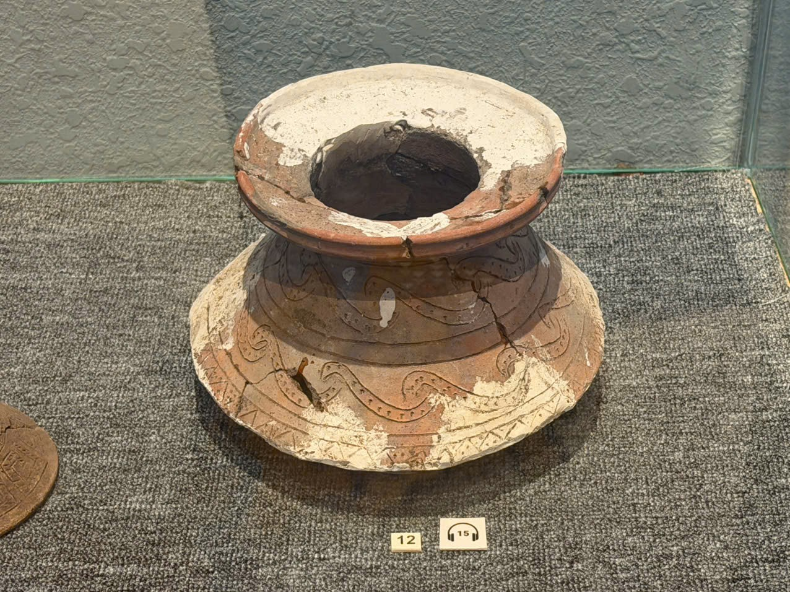

# Hiện vật gốm loe rộng — vị trí nhãn 12

Mã nội bộ: `PHOTO-001`. **Hồ sơ nháp — chưa index vào Vision.**

Cơ sở đặt tên: Mô tả trực quan; chưa có bảng tên đọc được.

## Đặc điểm nhìn thấy

- Miệng mở lớn và vành dày loe ra ngoài
- Thân thắt ở giữa, phần dưới loe rộng
- Bề mặt nâu, nhiều mảng sáng và đường trang trí uốn cong

## Ảnh gốc và vai trò

### A01 — Ảnh hiện vật để duyệt làm tham chiếu

Góc nhìn từ trên xuống, toàn bộ hiện vật chính

## Ghi chú cần xác nhận

- Số 12 là nhãn vị trí nhìn thấy trong ảnh, không phải số đăng ký hay artifactId.

- Tên chính thức, bảo tàng, mã hiện vật và vị trí trong DB còn trống.
- Chọn ảnh phù hợp trước khi index; chưa có ảnh holdout độc lập để đánh giá độ chính xác.
- Chỉnh nguồn mô tả trong intake.json rồi chạy lại công cụ; các file hồ sơ là bản sinh ra từ nguồn đó.
