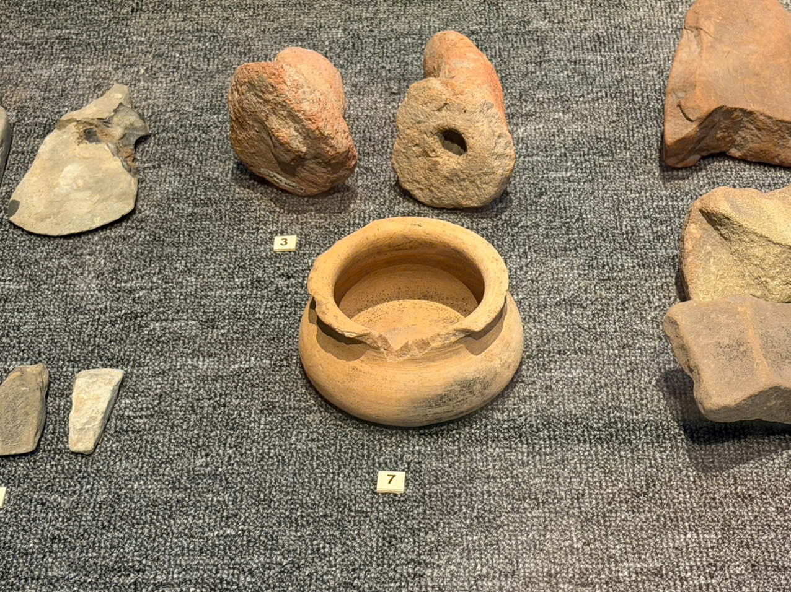

# Vật đựng gốm miệng vỡ — vị trí nhãn 7

Mã nội bộ: `PHOTO-002`. **Hồ sơ nháp — chưa index vào Vision.**

Cơ sở đặt tên: Mô tả trực quan; chưa có tên chính thức.

## Đặc điểm nhìn thấy

- Dáng thân tròn thấp, màu vàng nâu
- Miệng tròn rộng, mép trước có phần vỡ khuyết
- Có các đường gờ ngang quanh thân

## Ảnh gốc và vai trò

### A03 — Ảnh hiện vật để duyệt làm tham chiếu

Hiện vật miệng vỡ ở giữa ảnh; góc nhìn từ trên xuống

## Ghi chú cần xác nhận

- Chỉ đối tượng ở giữa ảnh A03; không bao gồm các đồ vật đá ở xung quanh.

- Tên chính thức, bảo tàng, mã hiện vật và vị trí trong DB còn trống.
- Chọn ảnh phù hợp trước khi index; chưa có ảnh holdout độc lập để đánh giá độ chính xác.
- Chỉnh nguồn mô tả trong intake.json rồi chạy lại công cụ; các file hồ sơ là bản sinh ra từ nguồn đó.
