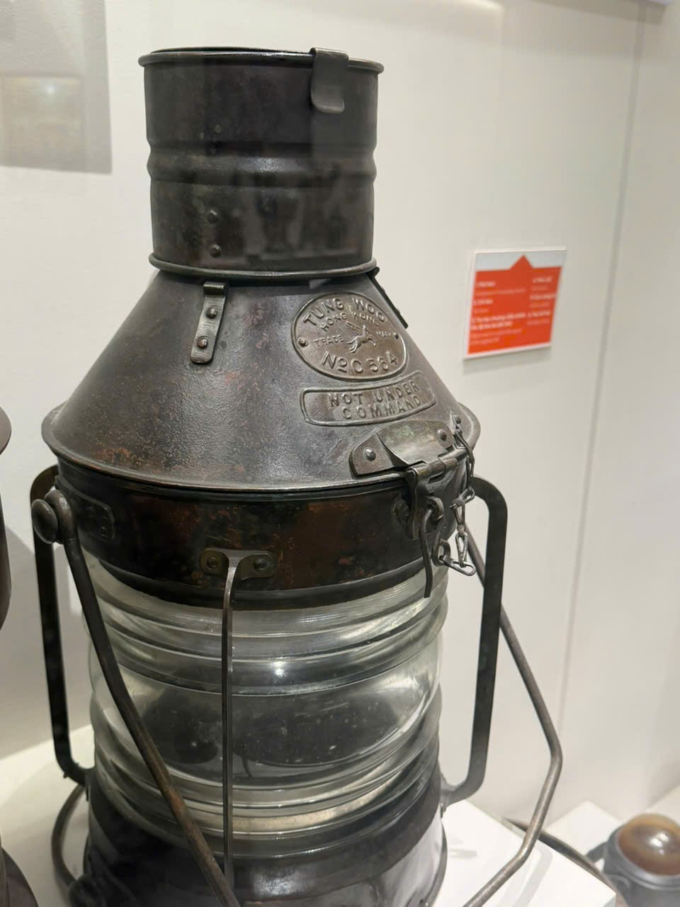
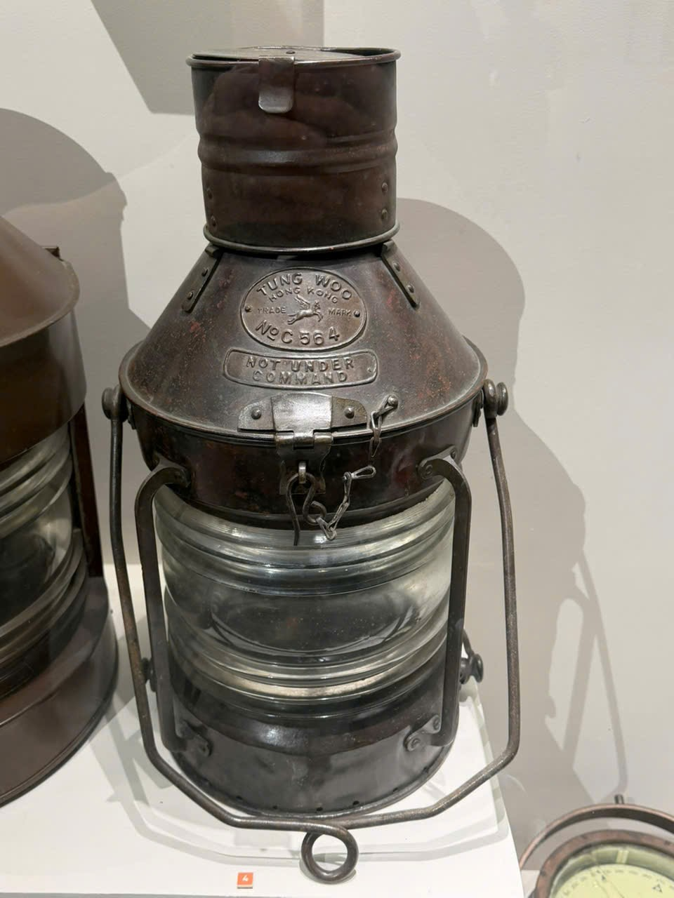

# Đèn có chữ C564

Mã nội bộ: `PHOTO-003`. **Hồ sơ nháp — chưa index vào Vision.**

Cơ sở đặt tên: Chữ C564 nhìn thấy trên thân; tên mô tả chưa được bảo tàng xác nhận.

## Đặc điểm nhìn thấy

- Thân tối màu với phần vai hình nón cụt
- Mảng chữ nổi TUNG WOO, C564 và NOT UNDER COMMAND
- Phần kính nhiều gờ ngang, có khung bảo vệ và khóa kèm xích

## Ảnh gốc và vai trò

### A04 — Ảnh hiện vật để duyệt làm tham chiếu

Đèn C564 nhìn chếch; phần đáy bị cắt

### A05 — Ảnh hiện vật để duyệt làm tham chiếu

Đèn C564 nhìn gần chính diện

### A12 — Ảnh trùng, không tính thêm mẫu

Trùng byte với A05

## Ghi chú cần xác nhận

- Ảnh A05 và A12 trùng hoàn toàn theo SHA-256. Không dùng A12 làm ảnh bổ sung hoặc holdout.
- Chưa xác nhận niên đại, công dụng hay đơn vị chế tạo ngoài chữ nhìn thấy trên ảnh.

- Tên chính thức, bảo tàng, mã hiện vật và vị trí trong DB còn trống.
- Chọn ảnh phù hợp trước khi index; chưa có ảnh holdout độc lập để đánh giá độ chính xác.
- Chỉnh nguồn mô tả trong intake.json rồi chạy lại công cụ; các file hồ sơ là bản sinh ra từ nguồn đó.
