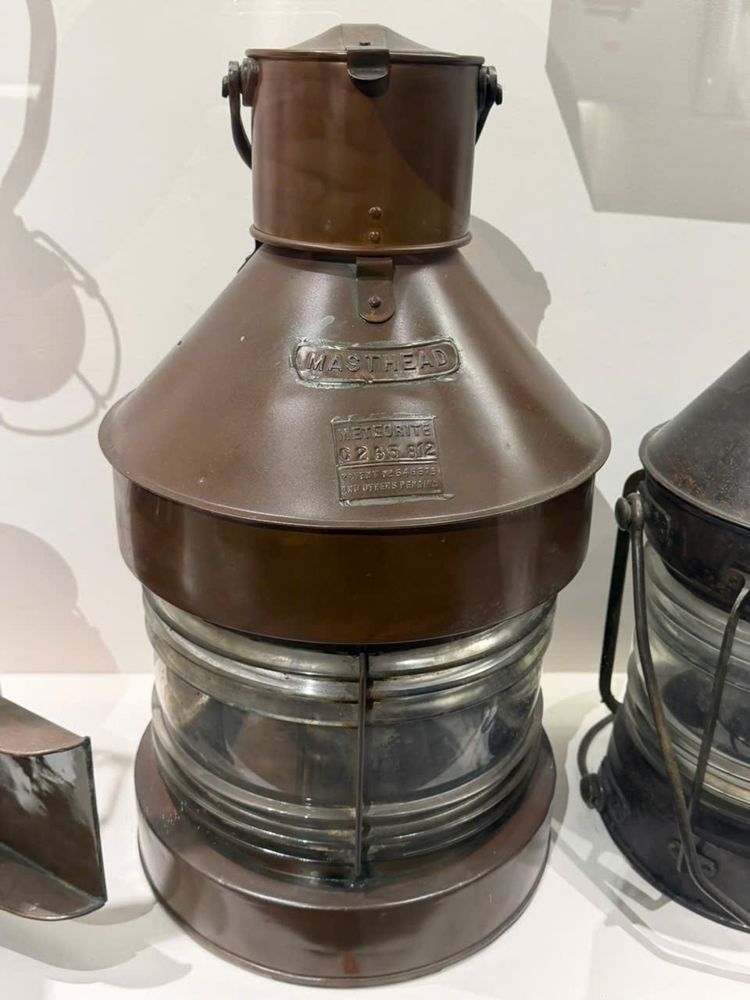

# Đèn có chữ MASTHEAD

Mã nội bộ: `PHOTO-004`. **Hồ sơ nháp — chưa index vào Vision.**

Cơ sở đặt tên: Chữ MASTHEAD nhìn thấy trong ảnh; tên mô tả.

## Đặc điểm nhìn thấy

- Phần thân trên màu nâu, vai hình nón cụt rộng
- Chữ MASTHEAD nổi ở mặt trước
- Phần kính phía dưới có nhiều gờ ngang và một thanh dọc ở trước

## Ảnh gốc và vai trò

### A06 — Ảnh hiện vật để duyệt làm tham chiếu

Đèn ghi MASTHEAD nhìn chính diện

## Ghi chú cần xác nhận

- Không gộp với đèn C564 hoặc đèn PORT dù có dáng gần giống.

- Tên chính thức, bảo tàng, mã hiện vật và vị trí trong DB còn trống.
- Chọn ảnh phù hợp trước khi index; chưa có ảnh holdout độc lập để đánh giá độ chính xác.
- Chỉnh nguồn mô tả trong intake.json rồi chạy lại công cụ; các file hồ sơ là bản sinh ra từ nguồn đó.
