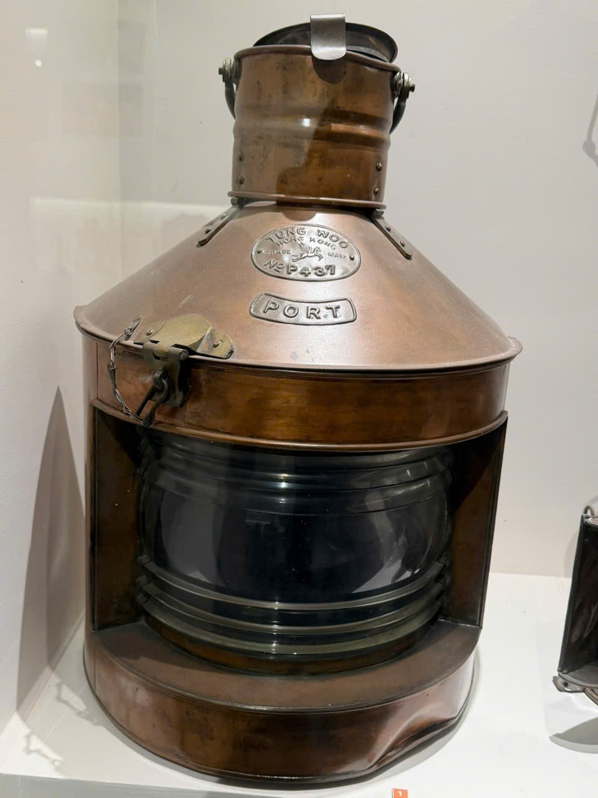

# Đèn có chữ PORT

Mã nội bộ: `PHOTO-005`. **Hồ sơ nháp — chưa index vào Vision.**

Cơ sở đặt tên: Chữ PORT nhìn thấy trong ảnh; tên mô tả.

## Đặc điểm nhìn thấy

- Vai đèn màu nâu ánh kim với chữ PORT nổi
- Phần kính cong sẫm màu, có các gờ ngang
- Hai tấm bên hông và khóa/xích ở phía trước lệch trái

## Ảnh gốc và vai trò

### A07 — Ảnh hiện vật để duyệt làm tham chiếu

Đèn ghi PORT nhìn chính diện

## Ghi chú cần xác nhận

- Không suy ra chức năng hàng hải, niên đại hoặc quốc gia chỉ từ chữ PORT.

- Tên chính thức, bảo tàng, mã hiện vật và vị trí trong DB còn trống.
- Chọn ảnh phù hợp trước khi index; chưa có ảnh holdout độc lập để đánh giá độ chính xác.
- Chỉnh nguồn mô tả trong intake.json rồi chạy lại công cụ; các file hồ sơ là bản sinh ra từ nguồn đó.
