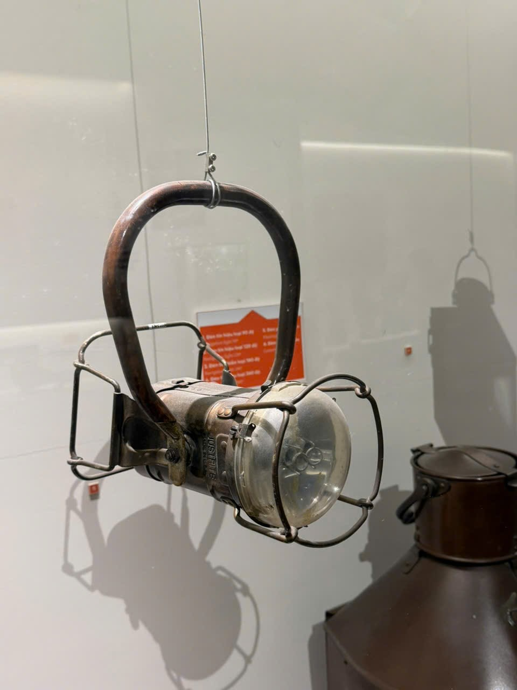
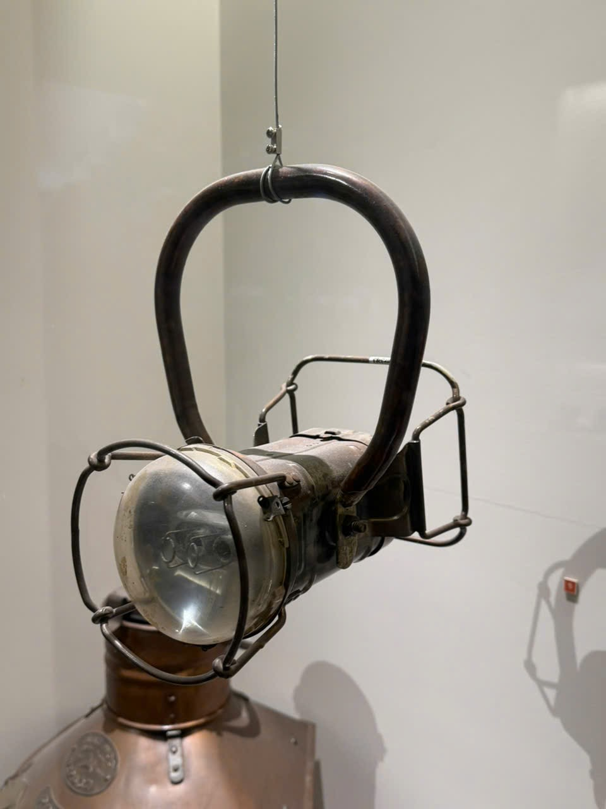

# Đèn cầm tay có quai lớn và khung bảo vệ

Mã nội bộ: `PHOTO-006`. **Hồ sơ nháp — chưa index vào Vision.**

Cơ sở đặt tên: Mô tả trực quan, cần tên chính thức.

## Đặc điểm nhìn thấy

- Quai xách lớn dạng vòng, phía trên có dây treo
- Mặt kính tròn ở một đầu thân hình trụ
- Khung kim loại bao quanh mặt kính và phần thân phía sau

## Ảnh gốc và vai trò

### A08 — Ảnh hiện vật để duyệt làm tham chiếu

Đèn treo có quai lớn, nhìn chếch một phía

### A09 — Ảnh hiện vật để duyệt làm tham chiếu

Đèn treo có quai lớn, nhìn chếch phía còn lại

## Ghi chú cần xác nhận

- A08 và A09 cho hai góc của cùng nhóm đèn; vẫn cần người phụ trách xác nhận cách ghép.

- Tên chính thức, bảo tàng, mã hiện vật và vị trí trong DB còn trống.
- Chọn ảnh phù hợp trước khi index; chưa có ảnh holdout độc lập để đánh giá độ chính xác.
- Chỉnh nguồn mô tả trong intake.json rồi chạy lại công cụ; các file hồ sơ là bản sinh ra từ nguồn đó.
