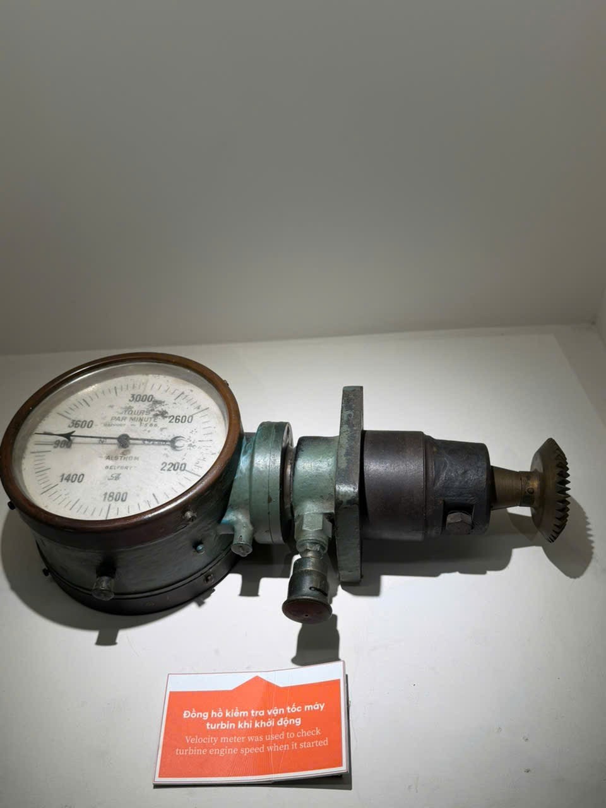
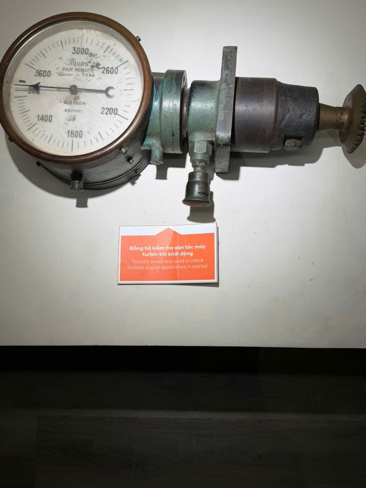

# Đồng hồ kiểm tra vận tốc máy turbin khi khởi động

Mã nội bộ: `PHOTO-007`. **Hồ sơ nháp — chưa index vào Vision.**

Cơ sở đặt tên: Chép tên từ bảng trong A10/A11, chưa đối chiếu hồ sơ bảo tàng.

## Đặc điểm nhìn thấy

- Mặt số tròn nền sáng, các số và kim tối màu
- Có chữ ALSTHOM và BELFORT đọc được trên mặt số
- Phần thân nối dài sang phải với đầu bánh răng

## Ảnh gốc và vai trò

### A10 — Ảnh hiện vật để duyệt làm tham chiếu

Đồng hồ và bảng tên trong cùng ảnh

### A11 — Ảnh hiện vật để duyệt làm tham chiếu

Đồng hồ gần cùng mặt trước với A10; mép phải bị cắt

## Nội dung đọc từ bảng tên

Phần chép lại dưới đây chưa được đối chiếu hồ sơ bảo tàng.

Nguồn: A10

> Đồng hồ kiểm tra vận tốc máy turbin khi khởi động

## Ghi chú cần xác nhận

- Hai ảnh gần cùng mặt trước; chưa đủ bộ kiểm thử độc lập. Không tự gán dải đo/đơn vị đo từ các số trên mặt đồng hồ.

- Tên chính thức, bảo tàng, mã hiện vật và vị trí trong DB còn trống.
- Chọn ảnh phù hợp trước khi index; chưa có ảnh holdout độc lập để đánh giá độ chính xác.
- Chỉnh nguồn mô tả trong intake.json rồi chạy lại công cụ; các file hồ sơ là bản sinh ra từ nguồn đó.
