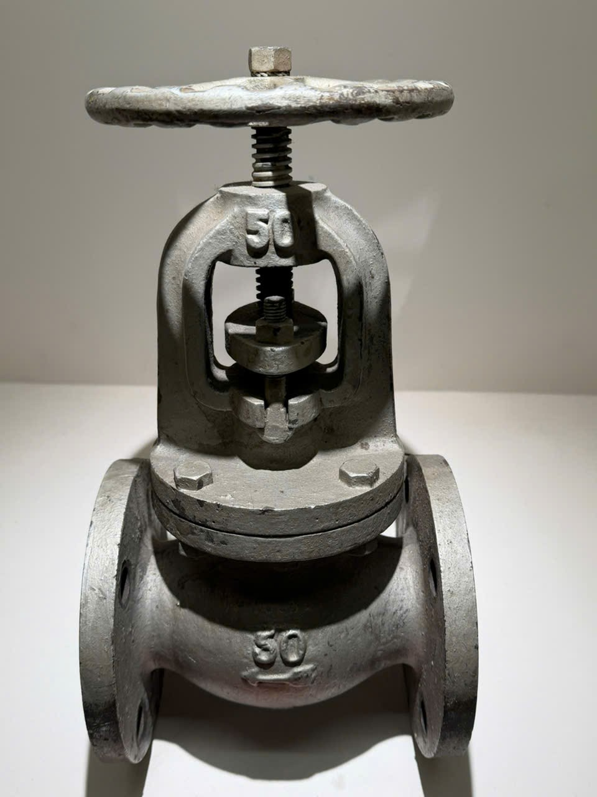
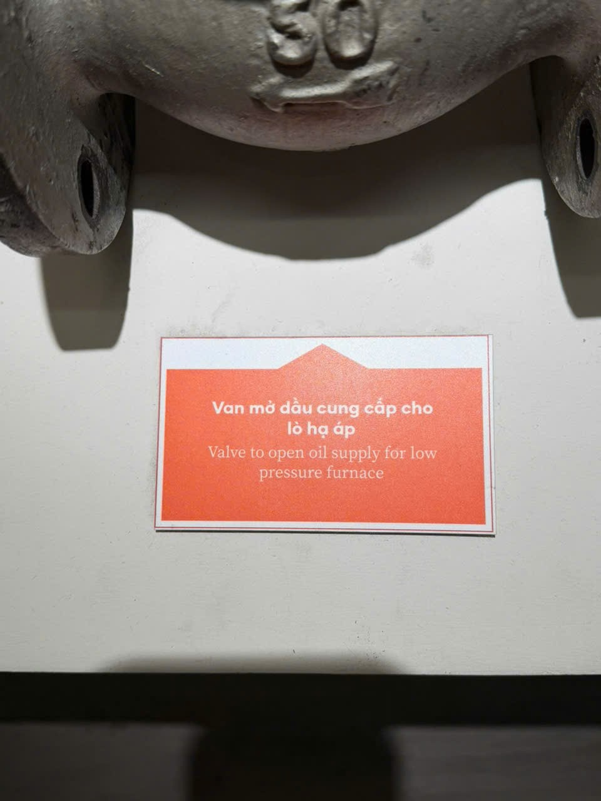

# Van mở dầu cung cấp cho lò hạ áp

Mã nội bộ: `PHOTO-008`. **Hồ sơ nháp — chưa index vào Vision.**

Cơ sở đặt tên: Chép tên từ bảng A14, chưa đối chiếu hồ sơ bảo tàng.

## Đặc điểm nhìn thấy

- Tay quay lớn dạng vòng tròn ở trên
- Trục ren thẳng đứng, khung cong bao quanh phần giữa
- Thân bên dưới có hai mặt bích và số 50 nổi

## Ảnh gốc và vai trò

### A13 — Ảnh hiện vật để duyệt làm tham chiếu

Van với tay quay tròn và số 50 ở thân

### A14 — Ảnh bảng tên, bổ sung thông tin

Bảng tên dưới van; chỉ thấy một phần chân hiện vật

## Nội dung đọc từ bảng tên

Phần chép lại dưới đây chưa được đối chiếu hồ sơ bảo tàng.

Nguồn: A14

> Van mở dầu cung cấp cho lò hạ áp

## Ghi chú cần xác nhận

- A14 là ảnh bảng tên, không phải ảnh tham chiếu độc lập. Số 50 không được gán thành mã hiện vật hay thông số kỹ thuật khi chưa xác nhận.

- Tên chính thức, bảo tàng, mã hiện vật và vị trí trong DB còn trống.
- Chọn ảnh phù hợp trước khi index; chưa có ảnh holdout độc lập để đánh giá độ chính xác.
- Chỉnh nguồn mô tả trong intake.json rồi chạy lại công cụ; các file hồ sơ là bản sinh ra từ nguồn đó.
