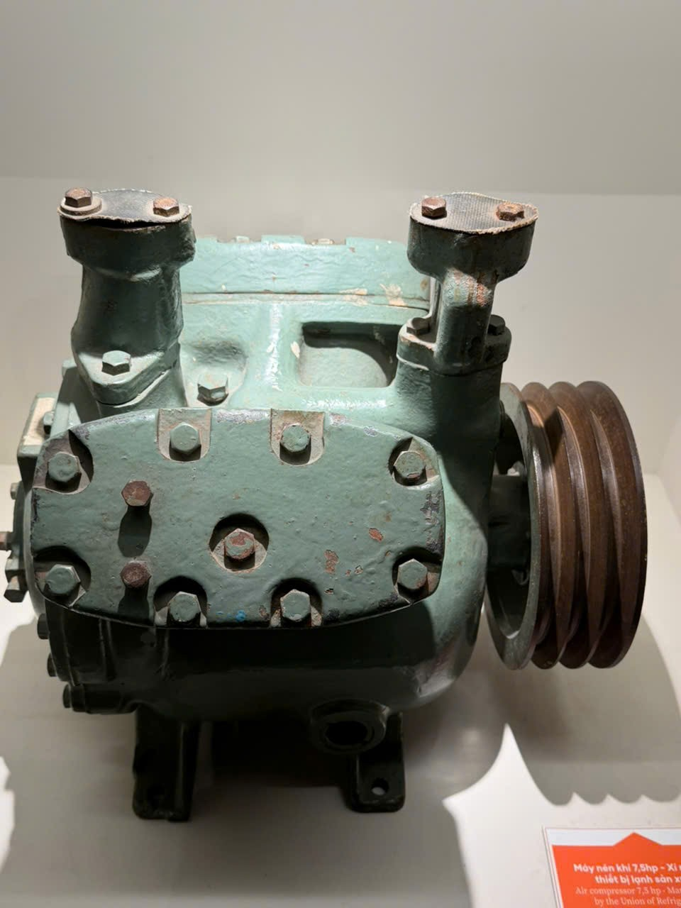
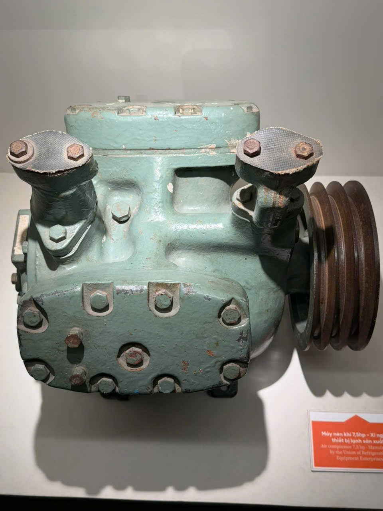
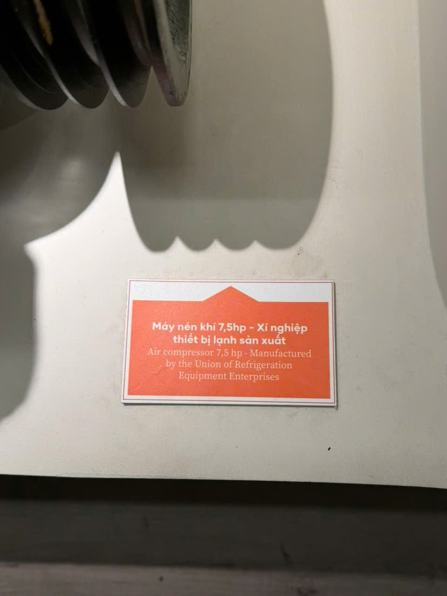

# Máy nén khí 7,5 hp

Mã nội bộ: `PHOTO-009`. **Hồ sơ nháp — chưa index vào Vision.**

Cơ sở đặt tên: Bảng tên B01 được ghép tạm với A15/A16 dựa trên bộ puli và bối cảnh.

## Đặc điểm nhìn thấy

- Thân màu xanh nhạt, bề mặt có các mảng bong sơn
- Mặt trước có nhiều bu-lông xếp quanh nắp
- Bộ puli nhiều rãnh ở bên phải và hai cụm ống phía trên

## Ảnh gốc và vai trò

### A15 — Ảnh hiện vật để duyệt làm tham chiếu

Máy màu xanh với bộ puli bên phải, nhìn chếch

### A16 — Ảnh hiện vật để duyệt làm tham chiếu

Máy màu xanh nhìn gần chính diện

### B01 — Ảnh bảng tên, bổ sung thông tin

Bảng tên máy nén; thấy một phần puli ở góc trên

## Nội dung đọc từ bảng tên

Phần chép lại dưới đây chưa được đối chiếu hồ sơ bảo tàng.

Nguồn: B01

> Máy nén khí 7,5hp - Xí nghiệp thiết bị lạnh sản xuất

## Ghi chú cần xác nhận

- Cần người phụ trách xác nhận B01 là bảng tên của đúng máy trong A15/A16.
- Không tự bổ sung năm sản xuất, nước sản xuất hoặc thời kỳ sử dụng.

- Tên chính thức, bảo tàng, mã hiện vật và vị trí trong DB còn trống.
- Chọn ảnh phù hợp trước khi index; chưa có ảnh holdout độc lập để đánh giá độ chính xác.
- Chỉnh nguồn mô tả trong intake.json rồi chạy lại công cụ; các file hồ sơ là bản sinh ra từ nguồn đó.
