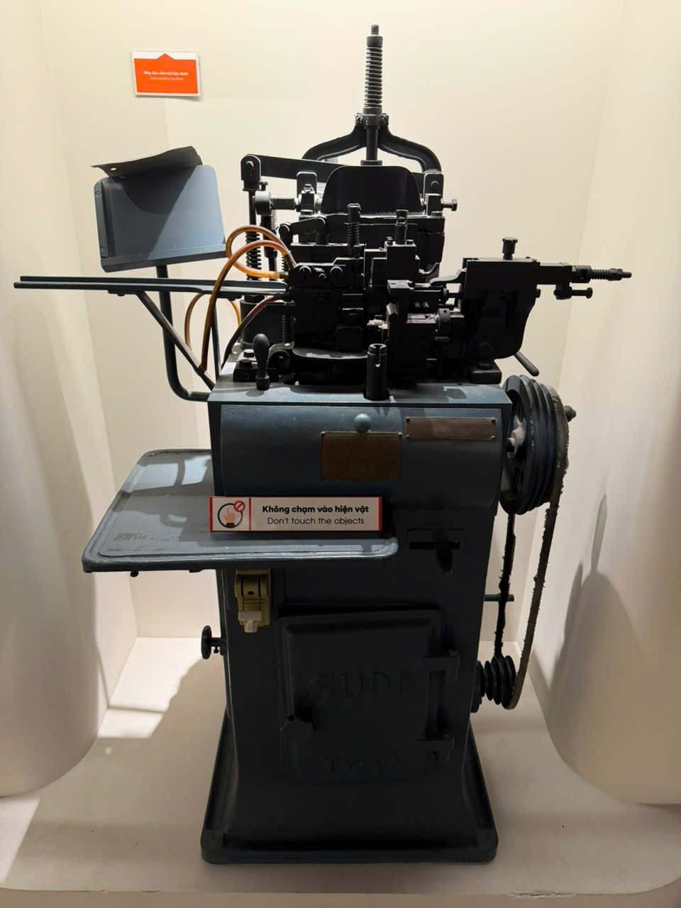

# Máy công nghiệp dạng đứng — tên tạm

Mã nội bộ: `PHOTO-010`. **Hồ sơ nháp — chưa index vào Vision.**

Cơ sở đặt tên: Chỉ mô tả ngoại hình; bảng tên trong ảnh chưa đọc rõ.

## Đặc điểm nhìn thấy

- Đế đứng cao màu xanh xám, phần trên tối màu
- Có trục ren thẳng đứng và nhiều cụm cơ cấu phía trên
- Bánh đai và dây truyền ở bên phải, mặt bàn nhỏ phía trước

## Ảnh gốc và vai trò

### B02 — Ảnh hiện vật để duyệt làm tham chiếu

Toàn bộ máy công nghiệp dạng đứng

## Ghi chú cần xác nhận

- Chưa xác định tên/công dụng chính thức; không suy đoán từ dáng máy hay chữ mờ trên đế.

- Tên chính thức, bảo tàng, mã hiện vật và vị trí trong DB còn trống.
- Chọn ảnh phù hợp trước khi index; chưa có ảnh holdout độc lập để đánh giá độ chính xác.
- Chỉnh nguồn mô tả trong intake.json rồi chạy lại công cụ; các file hồ sơ là bản sinh ra từ nguồn đó.
