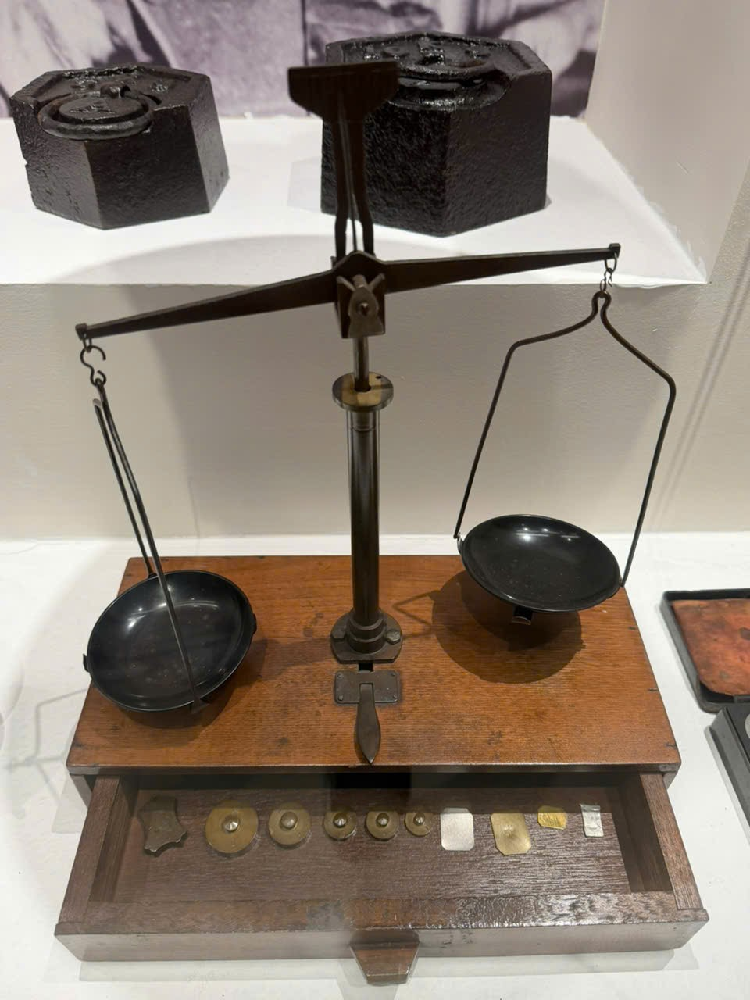

# Cân hai đĩa và ngăn quả cân — tên mô tả

Mã nội bộ: `PHOTO-011`. **Hồ sơ nháp — chưa index vào Vision.**

Cơ sở đặt tên: Mô tả trực quan; chưa có tên chính thức.

## Đặc điểm nhìn thấy

- Trụ đứng ở giữa, đòn cân ngang với hai đĩa treo
- Hai đĩa màu tối và dây/khung treo mảnh
- Đế dạng hộp gỗ, ngăn kéo mở có các quả cân

## Ảnh gốc và vai trò

### B03 — Ảnh hiện vật để duyệt làm tham chiếu

Cân hai đĩa với ngăn đựng quả cân

## Ghi chú cần xác nhận

- Hai khối màu đen ở nền sau không được đưa vào nhận dạng của cân. Chưa xác nhận vật liệu hay niên đại.

- Tên chính thức, bảo tàng, mã hiện vật và vị trí trong DB còn trống.
- Chọn ảnh phù hợp trước khi index; chưa có ảnh holdout độc lập để đánh giá độ chính xác.
- Chỉnh nguồn mô tả trong intake.json rồi chạy lại công cụ; các file hồ sơ là bản sinh ra từ nguồn đó.
