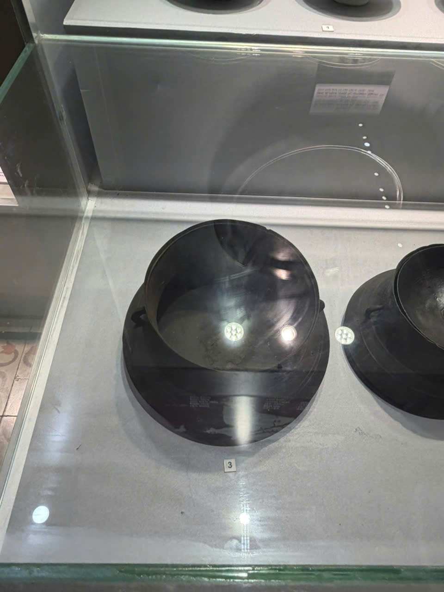
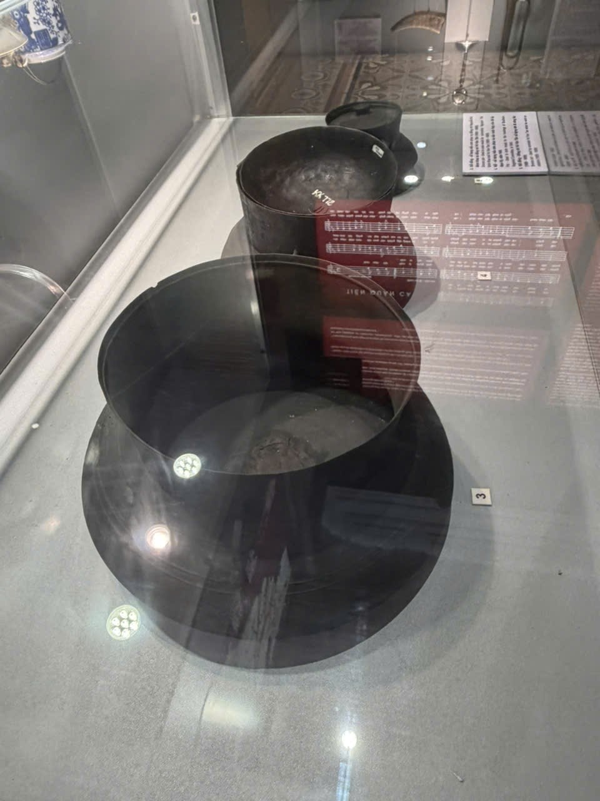

# Hiện vật dạng lòng chảo màu sẫm — vị trí nhãn 3

Mã nội bộ: `PHOTO-012`. **Hồ sơ nháp — chưa index vào Vision.**

Cơ sở đặt tên: Mô tả trực quan; chưa xác định loại/tên hiện vật.

## Đặc điểm nhìn thấy

- Dáng tròn, lòng sâu, thành cao và bề mặt tối màu
- Vành tròn nổi quanh mép
- Trưng bày trong tủ kính, có nhãn vị trí 3 ở gần

## Ảnh gốc và vai trò

### B04 — Ảnh hiện vật để duyệt làm tham chiếu

Vật dạng lòng chảo màu sẫm ở vị trí nhãn 3

### B05 — Ảnh hiện vật để duyệt làm tham chiếu

Vật dạng lòng chảo ở phía trước, nhìn chếch; tạm ghép với B04

## Ghi chú cần xác nhận

- B04/B05 được ghép tạm theo hình dáng và vị trí nhãn; cần xác nhận là cùng một vật.
- Ảnh có phản chiếu kính mạnh; cần chọn vùng hiện vật trước khi duyệt indexing. Chưa gán là nồi, chậu, cồng hay loại khác.

- Tên chính thức, bảo tàng, mã hiện vật và vị trí trong DB còn trống.
- Chọn ảnh phù hợp trước khi index; chưa có ảnh holdout độc lập để đánh giá độ chính xác.
- Chỉnh nguồn mô tả trong intake.json rồi chạy lại công cụ; các file hồ sơ là bản sinh ra từ nguồn đó.
