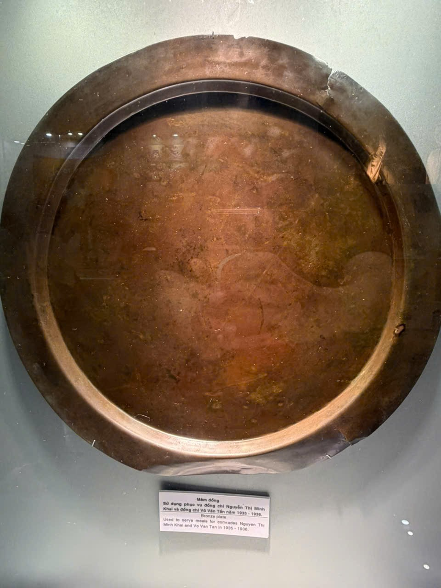

# Mâm đồng — theo bảng tên trong ảnh

Mã nội bộ: `PHOTO-013`. **Hồ sơ nháp — chưa index vào Vision.**

Cơ sở đặt tên: Bảng tên trong B06; chưa đối chiếu hồ sơ chính thức.

## Đặc điểm nhìn thấy

- Dạng tròn rộng và khá nông, màu nâu đỏ
- Vành rộng, có vết hư hại nhìn thấy ở góc trên bên phải
- Bảng tên nằm ngay phía dưới trong cùng ảnh

## Ảnh gốc và vai trò

### B06 — Ảnh hiện vật để duyệt làm tham chiếu

Mâm tròn và bảng tên trong cùng ảnh

## Nội dung đọc từ bảng tên

Phần chép lại dưới đây chưa được đối chiếu hồ sơ bảo tàng.

Nguồn: B06

> Mâm đồng
> Sử dụng phục vụ đồng chí Nguyễn Thị Minh Khai và đồng chí Võ Văn Tần năm 1935 - 1936.

## Ghi chú cần xác nhận

- Thông tin về người/năm sử dụng chỉ được chép lại từ nhãn, không coi là dữ kiện lịch sử đã kiểm chứng để tự sinh thuyết minh.

- Tên chính thức, bảo tàng, mã hiện vật và vị trí trong DB còn trống.
- Chọn ảnh phù hợp trước khi index; chưa có ảnh holdout độc lập để đánh giá độ chính xác.
- Chỉnh nguồn mô tả trong intake.json rồi chạy lại công cụ; các file hồ sơ là bản sinh ra từ nguồn đó.
