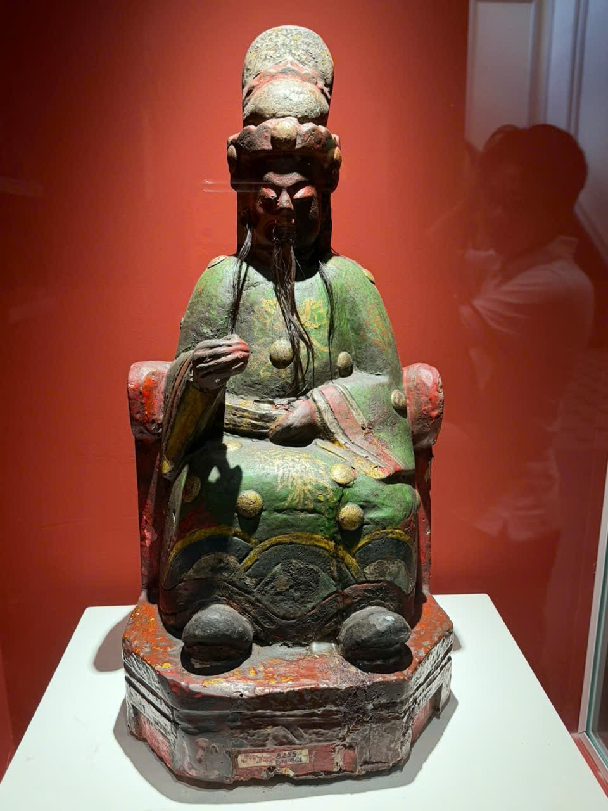

# Tượng nhân vật ngồi mặc trang phục xanh — tên tạm

Mã nội bộ: `PHOTO-014`. **Hồ sơ nháp — chưa index vào Vision.**

Cơ sở đặt tên: Mô tả ngoại hình; chưa có bảng tên đọc được.

## Đặc điểm nhìn thấy

- Nhân vật ngồi trên ghế, râu dài và mũ cao
- Trang phục màu xanh có nhiều họa tiết tròn màu vàng
- Bệ tượng tối màu, tủ có nền đỏ

## Ảnh gốc và vai trò

### B10 — Ảnh hiện vật để duyệt làm tham chiếu

Tượng nhân vật ngồi, trang phục xanh và râu dài

## Ghi chú cần xác nhận

- Không tự xác định danh tính nhân vật, tôn giáo, chất liệu, niên đại hoặc tên gọi chính thức từ ngoại hình.

- Tên chính thức, bảo tàng, mã hiện vật và vị trí trong DB còn trống.
- Chọn ảnh phù hợp trước khi index; chưa có ảnh holdout độc lập để đánh giá độ chính xác.
- Chỉnh nguồn mô tả trong intake.json rồi chạy lại công cụ; các file hồ sơ là bản sinh ra từ nguồn đó.
